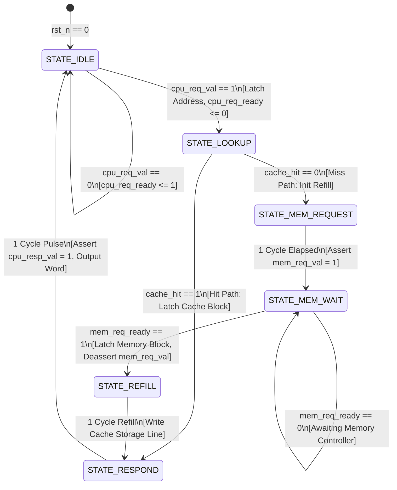

# Cache Controller FSM State Diagram & State Transitions

**Author:** Saksham (FSM Architect & Integration Lead)  
**Project:** Design and Analysis of a Direct-Mapped Cache Controller

---

## 1. FSM State Encoding

The cache controller is implemented as a 6-state Moore/Mealy hybrid Finite State Machine:

| State Name | Binary Encoding | Hex / Dec | Purpose & Actions |
|:---|:---|:---|:---|
| **`STATE_IDLE`** | `3'b000` | `3'd0` | Ready for new CPU request (`cpu_req_ready = 1`). Latches `cpu_req_addr` into `latched_addr_q` when `cpu_req_val = 1`. |
| **`STATE_LOOKUP`** | `3'b001` | `3'd1` | Evaluates tag and valid bit. If `cache_hit`, buffers line data and branches to `RESPOND`. If `cache_miss`, branches to `MEM_REQUEST`. |
| **`STATE_MEM_REQUEST`** | `3'b010` | `3'd2` | Generates single-cycle pulse `mem_req_val = 1` with block-aligned address `{req_tag, req_index, 4'b0000}`. |
| **`STATE_MEM_WAIT`** | `3'b011` | `3'd3` | Deasserts `mem_req_val = 0` to preserve protocol. Awaits `mem_req_ready = 1` from main memory. Latches 128-bit block into buffer. |
| **`STATE_REFILL`** | `3'b100` | `3'd4` | Drives `cache_write_en = 1`, `cache_write_valid = 1`, writing the 128-bit block and tag into cache line `req_index`. |
| **`STATE_RESPOND`** | `3'b101` | `3'd5` | Multiplexes 1 of 4 words based on `req_word_sel = latched_addr[3:2]`. Asserts `cpu_resp_val = 1`. Returns to `STATE_IDLE`. |

---

## 2. FSM State Transition Diagram



---

## 3. Cycle-Accurate Execution Trace

### A. Cache Hit Path (2 Clock Cycles)
```
Cycle:         1             2             3
CLK:     ____/   \_____/   \_____/   \_____/   \___
State:     |   IDLE    |   LOOKUP    |   RESPOND   |   IDLE
req_val:   /~~~~~~~~~~~\___________________________
req_addr:  ---< 0x1048 >---------------------------
req_ready: ~~~~~~~~~~~~\___________________________/~~~~~~~
hit:       ____________/~~~~~~~~~~~~~\_____________
resp_val:  __________________________/~~~~~~~~~~~~~\_______
resp_data: --------------------------< Word 2 Data >-------
```

### B. Cache Miss Path (With 2-Cycle Memory Latency: 5 Clock Cycles)
```
Cycle:       1         2          3             4            5          6          7
CLK:       __/ \_____/   \______/   \_________/   \________/   \______/   \______/   \___
State:     | IDLE |  LOOKUP  | MEM_REQUEST |  MEM_WAIT   |  REFILL  | RESPOND  | IDLE
req_val:   /~~~~~~\____________________________________________________________________
hit:       _______/ 0 (Miss) \_________________________________________________________
mem_val:   __________________/~~~~~~~~~~~~~\___________________________________________
mem_ready: ____________________________________________/~~~~~~~~\______________________
write_en:  _____________________________________________________/~~~~~~~\______________
resp_val:  ________________________________________________________________/~~~~~~~\___
resp_data: ----------------------------------------------------------------< Word >----
```
